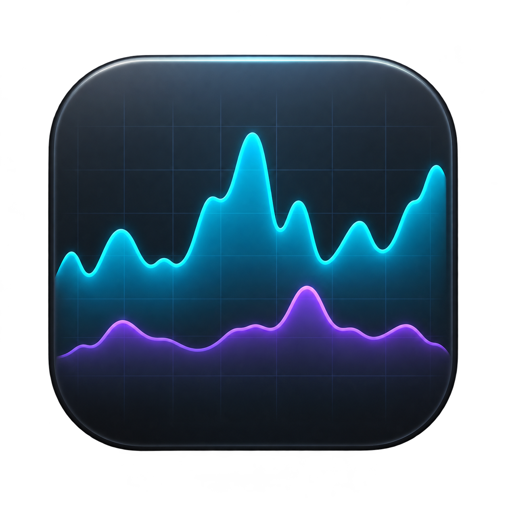

<div align="center">
  

  <h1>Performance Monitor</h1>
  <p><strong>O visual do Task Manager. Os dados do seu Mac.</strong></p>
  <p>CPU, memória, disco, rede e GPU em um app nativo feito com SwiftUI.</p>

  <p>
    
    
    
    
  </p>
</div>

---

Uma releitura da aba **Performance do Gerenciador de Tarefas do Windows 11** para macOS: interface escura, gráficos coloridos, amostras a cada segundo e histórico de 60 segundos. Os valores são coletados localmente pelas APIs do Mac.

## O que você pode acompanhar

| Painel | Em tempo real |
| :-- | :-- |
| **CPU** | Utilização geral ou por processador lógico, tempos do kernel, temperatura e tempo de atividade. |
| **Memória** | RAM em uso, composição, cache, disponível, wired, comprimida e swap usado/alocado com entrada e saída. |
| **Disco** | Leitura e escrita, atividade estimada, tempo médio de I/O e IOPS, com seleção do dispositivo físico. |
| **Rede** | Taxas de envio e recebimento agregadas das interfaces sem loopback. |
| **GPU** | Utilização geral, renderização, tiler, memória em uso/alocada e temperatura, quando expostos pelo hardware. |

### Um gráfico para cada processador

Clique com o botão direito no gráfico da CPU e escolha **Alterar gráfico para → Processadores lógicos**. No mesmo menu, ative **Mostrar tempos do kernel** para sobrepor uma linha tracejada ou use **Copiar resumo**. A preferência de visualização é salva entre execuções.

### GPU e temperaturas

O painel da GPU mostra os contadores globais do driver, com gráficos de utilização e memória. No Apple Silicon, a interface identifica a memória unificada como **compartilhada com a CPU**. As temperaturas vêm de sensores AppleSMC identificados; o valor exibido é o maior entre os sensores disponíveis de cada componente.

## Começar

**Requisitos:** macOS 14 ou superior e toolchain Swift 6. Para compilar, use o Xcode ou as Command Line Tools com um SDK compatível.

```sh
git clone https://github.com/JVini0166/macos-performance-monitor.git
cd macos-performance-monitor
swift run
```

Também é possível abrir `Package.swift` no Xcode e executar o target **PerformanceMonitor**.

## Gerar o aplicativo `.app`

```sh
bash scripts/build-app.sh
open "dist/Performance Monitor.app"
```

O script compila em modo Release, inclui o ícone e cria o bundle em `dist/`. A assinatura é local (*ad hoc*); o app não é notarizado para distribuição. Para instalar para seu usuário, copie **Performance Monitor.app** para `~/Applications`.

## Controles

| Ação | Como usar |
| :-- | :-- |
| Selecionar um painel | Clique no recurso na lista lateral. |
| Pausar ou retomar | **⌘P** ou o botão no canto superior direito. |
| Alternar o gráfico da CPU | Clique direito no gráfico ou use o menu de grade. |
| Recolher a navegação | Botão de barra lateral no topo da janela. |
| Trocar de disco ou GPU | Seletor no painel correspondente, quando houver dispositivos disponíveis. |

O histórico começa vazio na GPU e zerado nos demais recursos, sendo preenchido com novas amostras. A pausa congela os valores e os gráficos; ao retomar, os contadores de taxa restabelecem sua base.

## Precisão e compatibilidade

O layout se inspira no Windows; os contadores respeitam a arquitetura do macOS.

- **Disco:** leitura e escrita são medidas por diferenças dos contadores de I/O. O tempo ativo é uma estimativa e pode superestimar atividade com operações paralelas.
- **RAM:** apps, cache e disponível são estimativas a partir das páginas do kernel. Swap usado e alocado são lidos diretamente do sistema.
- **GPU:** os contadores variam por driver. Encode/decode e VRAM dedicada não são expostos nesta versão; dados ausentes aparecem como indisponíveis.
- **Temperatura:** há mapas para Apple M5 e sensores convencionais Intel. Outros chips precisam de validação dos sensores. Uma leitura ausente nunca é substituída por uma temperatura inventada.
- **Rede:** interfaces virtuais e túneis podem causar contagem duplicada.

Consulte [contadores, fórmulas e referências](docs/METRICS.md) para os detalhes de cada métrica, diferenças entre sistemas e fontes da Microsoft e da Apple.

## Desenvolvimento

```sh
swift build
swift test
```

Os testes verificam taxas de I/O, reinício de contadores, dados inválidos de GPU, decodificação térmica e coleta local com pausa. Os testes de integração esperam um Mac com disco físico e GPU Metal; a verificação térmica adicional se aplica ao Apple M5.

```text
Sources/PerformanceMonitor/
├── App.swift                 # Janela, navegação e gráficos
├── Metrics.swift             # Amostragem e históricos
├── DiskMetrics.swift         # I/O dos discos físicos via IOKit
├── GPUMetrics.swift          # Identificação Metal e contadores do driver
├── GPUPerformanceView.swift  # Painel da GPU
└── TemperatureReader.swift   # Leitura dos sensores AppleSMC
```

**Local por padrão:** sem telemetria, serviços externos, bibliotecas de terceiros ou helper privilegiado. O app apenas lê os contadores; não altera ventoinhas ou configurações do sistema.

---

Projeto independente, inspirado no Task Manager. Sem vínculo com a Microsoft ou a Apple.
